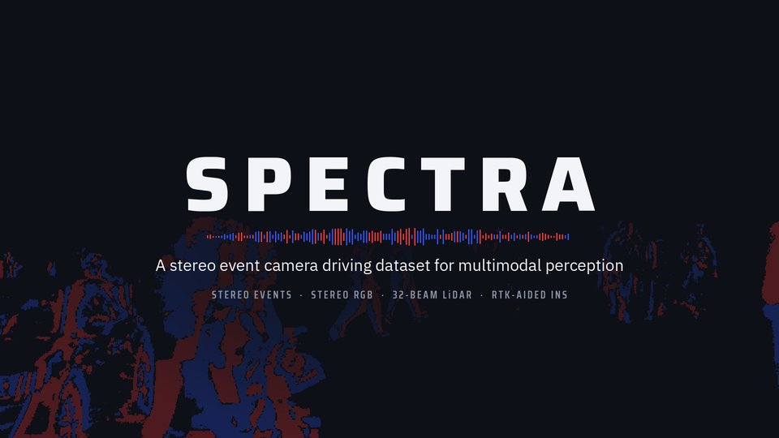
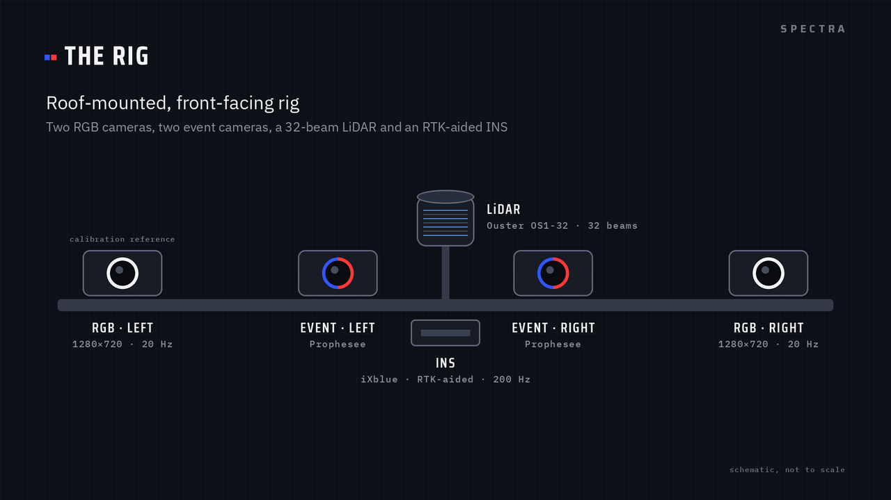
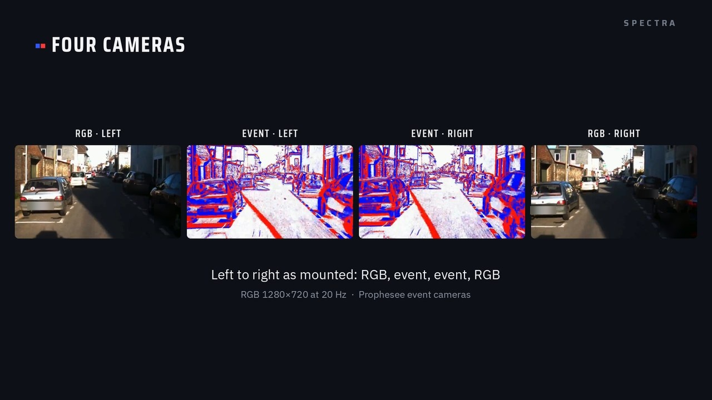

<p align="center">
  <a href="docs/media/spectra_teaser.mp4">
    
  </a>
</p>

<p align="center">
  <b>A stereo event camera driving dataset for multimodal perception</b><br>
  <i>Stereo events meet stereo RGB, LiDAR and RTK-INS, on the road.</i>
</p>

<p align="center">
  <a href="https://openreview.net/forum?id=mqCUxEsfsI"></a>
  <a href="#download"></a>
  <a href="toolkit/README.md"></a>
  <a href="LICENSE"></a>
  <a href="https://anr.fr/Project-ANR-21-CE22-0006"></a>
</p>

<p align="center">
  <a href="#key-numbers">Key numbers</a> ·
  <a href="#sensor-rig">Sensor rig</a> ·
  <a href="#whats-in-the-dataset">Data</a> ·
  <a href="#folder-layout">Layout</a> ·
  <a href="#toolkit">Toolkit</a> ·
  <a href="#download">Download</a> ·
  <a href="#citation">Citation</a>
</p>

---

**SPECTRA** is a multi-sensor driving dataset that pairs **stereo event cameras** with **stereo RGB cameras**, a
**32-beam LiDAR** and an **RTK-aided INS**, with **dense pseudo ground-truth depth**, **disparity** and **semantic
segmentation**. It was recorded from a roof-mounted rig in day, dawn, night, urban, suburban and tunnel conditions
by the LITIS laboratory (Normandie Université / INSA Rouen), within the
**[ANR CERBERE project](https://litis-cerbere.univ-rouen.fr/)** on event cameras for the perception of autonomous
vehicles.

## News

- **2026-10-30**: disparity maps for every depth frame (`depth/disparity/`), and the [toolkit](toolkit/README.md):
  readers, depth and event viewers, full right-camera semantic labels, raw-bag extraction.
- **2025**: paper at the IROS 2025 Workshop on Neuromorphic Perception for Real World Robotics (NeuRobots).

## Key numbers

| 🎬 **27** sequences | ⏱️ **26.1 min** | 🛣️ **10.7 km** | 📅 **5** recording days |
|:---:|:---:|:---:|:---:|
| 📷 **31,206** stereo RGB pairs | 🌊 **29,292** frames with dense depth | ⚡ **28.4 billion** events | 💾 about **820 GB** |

<details>
<summary><b>All numbers</b></summary>

| | |
|---|---|
| Sequences | **27** |
| Total duration | **26.1 min** |
| Distance driven | **10.7 km** |
| Recording days | **5** (October 2024 to July 2025) |
| Stereo RGB pairs | **31,206** |
| Frames with dense depth | **29,292** (pseudo ground truth up to 50 m) |
| Events | **28.4 billion** (two event cameras) |
| Cameras | **4** (2 RGB + 2 event) |
| RGB resolution / rate | **1280×720 at 20 Hz** |
| LiDAR | **Ouster OS1-32** (32 beams, 20 Hz) |
| INS | **iXblue, RTK-aided, 200 Hz** |
| Calibration | **3** epochs, plus one `calib.yaml` per sequence |
| Annotations | semantic segmentation (both RGB cameras), dense depth, disparity |
| Size | about **820 GB** in total, of which about **594 GB** are the raw ROS bags |

</details>

## Sensor rig

<p align="center"></p>

The rig sits on the vehicle roof and faces forward. From left to right: RGB, event, event, RGB. The LiDAR is
mounted above and slightly behind the camera bar, nearly centred between the two RGB cameras. The INS is on the
platform. The reference frame for all extrinsics is the raw left RGB camera, `rgb_left`.

| | Sensor | Model |
|---|---|---|
| ⚡ | 2 × event camera | Prophesee EVK4 |
| 📷 | 2 × RGB camera, global shutter | FLIR Blackfly S |
| 📡 | LiDAR | Ouster OS1-32 |
| 🛰️ | INS / GNSS, RTK-aided | iXblue ATLANS A7 |

<p align="center"></p>

The event cameras record a **20 Hz hardware trigger**, GPS-aligned, with two edges per RGB exposure. The RGB
images carry **PC-clock timestamps**. See the [data notes](docs/DATA_NOTES.md#timing) for what this means in use.

## What's in the dataset

### Sensors and data products

| Modality | Sensor | Rate / format | Files (per sequence) |
|---|---|---|---|
| Stereo RGB | 2 RGB cameras, 1280×720 | 20 Hz, PNG, raw (distorted) | `rgb/{left,right}/<timestamp_ns>.png` |
| Stereo events | 2 Prophesee event cameras | asynchronous, HDF5 | `events/left.h5`, `events/right.h5` |
| Event trigger | event-camera trigger input, GPS-aligned | 2 edges per RGB exposure | `events/trigger.txt` |
| LiDAR | Ouster OS1-32 | 20 Hz | in the raw bag; accumulated map `lidar_ins/scans.pcd` |
| INS / GNSS | iXblue INS with RTK | 200 Hz | in the raw bag |
| Trajectory | LiDAR-inertial odometry (Faster-LIO) | per scan | `lidar_ins/traj.txt` |
| Raw recording | all sensors | ROS 1 bag | `raw/<id>.bag` |
| Previews | RGB and event videos | AVI | `preview/rgb.avi`, `preview/events.avi` |

### Annotation layers

| Layer | What it is | Where |
|---|---|---|
| Semantic segmentation | Per-pixel Cityscapes classes (DeepLabV3+), both RGB cameras, on the raw images | `semantic/{left,right}/` |
| Dense depth | LiDAR map projected into the rectified left image and densified with a segmentation-guided fill, up to 50 m; with the measured points (`sparse`), a per-pixel support map and a moving-object mask | `depth/{dense,sparse,support,moving}/`, `depth/frames.csv`, `depth/meta.json` |
| Disparity | Stereo disparity of the rectified left image, from the dense depth | `depth/disparity/` |
| Stereo pairs | Left/right pairing of every frame and the stereo rectification | `pairs.csv`, `calib.yaml` |

### Dense depth

<p align="center"></p>
<p align="center"><sub>2024-11-29-11-27-15 (day_suburbs), left camera: RGB, events and dense depth of the same frames. Depth colours: 4 m (red) to 50 m (blue), log scale.</sub></p>

Depth comes from the LiDAR. Where the LiDAR measured, the value is the LiDAR's; where it did not, depth is spread
from LiDAR points of the same semantic region.

1. **Map projection.** The LiDAR scans of a sequence are registered with Faster-LIO into one map. At each frame it
   is projected into the rectified left image with the sequence's calibration.
2. **Visibility.** Map points hidden behind closer surfaces are removed with a geometric test, so a wall does not
   show the street behind it.
3. **Live sweeps.** A map built over a drive keeps traces where cars passed. Each frame is checked against the
   LiDAR sweep closest in time: the sweep replaces the map on moving objects, which go into the moving-object mask.
4. **Segmentation-guided fill.** Pixels without LiDAR take depth from nearby LiDAR points of the same class in the
   semantic segmentation, up to 50 m, so depth does not bleed across object borders.

**Why this way.** LiDAR alone is metric but sparse, and a map built from it misses or smears moving objects. Depth
from stereo networks is dense but less accurate, with softened edges. These maps keep the LiDAR values and use the
segmentation only to decide where they spread. Frames where the map could not be confirmed on the live sweeps are
left empty rather than guessed (1,739 of 31,031, listed in `depth/frames.csv`).

**Format.** 16-bit PNG, **depth in metres = value / 256**, 0 = no depth, on the **rectified left** image
(`R_rect_left`, `P_rect_left` in `calib.yaml`).

### Disparity and right-camera labels

The semantic labels are made on the left camera, as in Cityscapes. To work on the right camera, use the
**disparity** (`depth/disparity/<stem>.png`, 16-bit, **disparity in pixels = value / 64**, 0 = none): a pixel
(x, y) of the rectified left image is seen at (x − disparity, y) in the rectified right image. The toolkit turns
any left label map into a **complete right label map** with this geometry, and says for every pixel how it was
obtained.

<p align="center"></p>

### Sequences

Every sequence is named after the **local start time of its recording** (Europe/Paris), `YYYY-MM-DD-HH-MM-SS`.
The original recording name is kept in `sequences.csv`, column `recording_name`.

| Session | Sequence ids (recording name) | Condition | Calibration |
|---|---|---|---|
| 2024-10-03 | `2024-10-03-15-01-07` (street_03) | 🏙️ street, day | 2024-10 |
| 2024-10-24 | `2024-10-24-08-15-20` (dawn_01), `2024-10-24-08-15-34` (dawn_02) | 🌅 dawn, low light | 2024-10 |
| 2024-11-28 | `2024-11-28-18-25-59` (night_suburbs2) | 🌙 night, suburbs | 2024-11 |
| 2024-11-29 | `2024-11-29-11-08-17` (tunnel_day1), `2024-11-29-11-13-51` (tunnel_day2), `2024-11-29-11-27-15` (day_suburbs) | 🚇 tunnel, daytime suburbs | 2024-11 |
| 2025-07-22 | 20 sequences, `2025-07-22-15-51-18` to `2025-07-22-17-06-23` | ☀️ urban and suburban driving, afternoon | 2025-07 |

`sequences.csv` is the reference for the ids.

## Folder layout

The data folder and the unzipped downloads have the same tree:

```
SPECTRA/
├── README.md, LICENSE, sequences.csv, SHA256SUMS
├── calibration/
│   └── {2024-10, 2024-11, 2025-07}/calib.yaml, source/
└── sequences/<id>/
    ├── calib.yaml, pairs.csv
    ├── rgb/{left,right}/<timestamp_ns>.png
    ├── semantic/{left,right}/
    ├── events/left.h5, right.h5, trigger.txt
    ├── lidar_ins/scans.pcd, traj.txt
    ├── depth/{dense,sparse,support,moving,disparity}/<timestamp_ns>.png, frames.csv, meta.json
    ├── preview/rgb.avi, events.avi
    └── raw/<id>.bag
```

- Frame names are PC-clock timestamps in nanoseconds. `rgb/left`, `semantic/left` and `depth/*` use the **left**
  stamp; `rgb/right` has its own stamps. Left and right frames are matched **only** through `pairs.csv`
  (`stem` → `right_file`), never by name.
- `rgb/` and `semantic/` are on the **raw (distorted)** images; `depth/` is on the **rectified left** image.

<details>
<summary><b>File formats</b></summary>

| File | Format | Notes |
|---|---|---|
| `rgb/*/*.png` | PNG, 1280×720 | raw (distorted); intrinsics in `calib.yaml` |
| `semantic/*/*.png` | PNG | Cityscapes palette colours, on the raw image |
| `events/left.h5`, `right.h5` | HDF5 | datasets `events/x`, `events/y`, `events/p`, `events/t`, `ms_to_idx`, `t_offset`. `t` is in µs after `t_offset`; `ms_to_idx[k]` is the index of the first event of millisecond `k`. May need `pip install hdf5plugin` |
| `events/trigger.txt` | text | one trigger edge per line (ns), two edges per RGB exposure |
| `lidar_ins/scans.pcd` | PCD | the accumulated LiDAR map, in the map frame |
| `lidar_ins/traj.txt` | text, 8 columns | `# timestamp x y z q_x q_y q_z q_w`: the IMU pose in the map frame, timestamp in seconds |
| `depth/dense/*.png`, `depth/sparse/*.png` | PNG, 16 bit | metres = value / 256, 0 = no depth |
| `depth/disparity/*.png` | PNG, 16 bit | pixels = value / 64, 0 = no disparity |
| `depth/support/*.png` | PNG, 8 bit | 0 = measured LiDAR point, 1 to 254 = distance in pixels to the nearest measured pixel, 255 = no depth |
| `depth/moving/*.png` | PNG, 8 bit | 255 = depth on an object that the live LiDAR sweep shows moving, 0 = not |
| `depth/frames.csv`, `depth/meta.json` | CSV, JSON | per-frame diagnostics of the depth run; encodings and rectified intrinsics |
| `pairs.csv` | CSV | `stem`, `left_file`, `right_file`, `t_left_ns`, `t_right_ns`, `dt_ms`, `residual_ms` |
| `raw/<id>.bag` | ROS 1 bag | all sensors |

</details>

## Toolkit

The [**toolkit**](toolkit/README.md) is a small Python package with scripts for the release files and the raw bags.

```bash
cd toolkit && pip install -r requirements.txt
```

| Script | What it does |
|---|---|
| `toolkit/scripts/quickstart_read.py` | opens one sequence and prints what a stereo frame holds |
| `toolkit/scripts/show_depth.py` | dense depth drawn on the rectified left image (PNG or MP4) |
| `toolkit/scripts/render_events.py` | event stream rendered as a video |
| `toolkit/scripts/label_right.py` | full semantic labels for the right RGB camera, from the left labels |
| `toolkit/scripts/raw_bag.py` | images, events, trigger, LiDAR scans and GNSS from a raw bag (same files as the release) |

```python
import spectra as sp

seq   = sp.Sequence("SPECTRA", "2024-10-24-08-15-20")
pair  = next(p for p in seq.pairs if seq.depth(p["stem"]) is not None)   # not every pair has depth

left  = seq.rgb(pair, "left")                 # raw left image (BGR)
labs  = seq.semantic(pair, "left")            # class ids, 255 = void
depth = seq.depth(pair["stem"])               # metres, rectified left image
rect  = seq.rig.rectify_image(left, "left")   # pixel-aligned with depth

with seq.events("left") as ev:                # 50 ms of left events around this frame
    t = int(pair["t_left_ns"]) // 1000
    events = ev.window(t - 25_000, t + 25_000)

right_labels, source = sp.label_right(seq.rig, labs, seq.disparity(pair["stem"]))
```

<details>
<summary><b>Without the toolkit: plain Python</b></summary>

```python
# pip install numpy opencv-python h5py hdf5plugin pyyaml
import csv, os, cv2, h5py, hdf5plugin, numpy as np, yaml

seq   = "SPECTRA/sequences/2024-10-24-08-15-20"
pairs = list(csv.DictReader(open(f"{seq}/pairs.csv")))
pair  = next(r for r in pairs if os.path.exists(f"{seq}/depth/dense/{r['stem']}.png"))

left  = cv2.imread(f"{seq}/rgb/left/{pair['left_file']}")        # raw (distorted) left image
right = cv2.imread(f"{seq}/rgb/right/{pair['right_file']}")      # its right partner
depth = cv2.imread(f"{seq}/depth/dense/{pair['stem']}.png", cv2.IMREAD_UNCHANGED) / 256.0   # metres

with h5py.File(f"{seq}/events/left.h5", "r") as f:
    ms = f["ms_to_idx"]
    i0, i1 = ms[len(ms) // 2], ms[len(ms) // 2 + 50]            # 50 ms in the middle of the drive
    x, y, p, t = (f["events"][k][i0:i1] for k in ("x", "y", "p", "t"))
    t_abs_us = t.astype(np.int64) + int(f["t_offset"][0])       # absolute time = t_offset + t

# depth lies on the rectified left image: rectify the RGB image to match it
c = yaml.safe_load(open(f"{seq}/calib.yaml"))
cam, rect = c["cameras"]["rgb_left"], c["stereo_rectification"]
fu, fv, cu, cv_ = cam["intrinsics_fu_fv_cu_cv"]
K = np.array([[fu, 0, cu], [0, fv, cv_], [0, 0, 1]])
mx, my = cv2.initUndistortRectifyMap(K, np.array(cam["distortion"]), np.array(rect["R_rect_left"]),
                                     np.array(rect["P_rect_left"])[:, :3], (1280, 720), cv2.CV_32FC1)
left_rect = cv2.remap(left, mx, my, cv2.INTER_LINEAR)           # pixel-aligned with depth
```

</details>

## Download

The data will be downloaded from the project page (link at publication): one archive per sequence and data type,
so you can fetch only the parts you need. Each archive holds paths relative to `SPECTRA/`, so unpacking several
archives rebuilds the tree above.

| Archive | Contents |
|---|---|
| `<id>_calib.zip` | `calib.yaml`, `pairs.csv` |
| `<id>_rgb.zip` | stereo RGB images |
| `<id>_semantic.zip` | segmentation, both cameras |
| `<id>_events.zip` | both event streams and the trigger file |
| `<id>_lidar_ins.zip` | LiDAR map and trajectory |
| `<id>_depth.zip` | dense depth, measured depth, support, moving mask, disparity, `frames.csv`, `meta.json` |
| `<id>_preview.zip` | the two preview videos |
| `<id>.bag` | the raw ROS 1 recording (single file, not zipped) |
| `calibration.zip` | the three epoch files and their sources |
| `sequences.csv` | one row per sequence (single file) |

After unpacking, check the tree with `cd SPECTRA && sha256sum -c --ignore-missing SHA256SUMS`.

## Calibration

| Epoch | Sequences | Camera calibration | LiDAR to camera | LiDAR to IMU |
|---|---|---|---|---|
| **2024-10** | the October 2024 sessions | Kalibr, 2024-11-04 (shared with 2024-11) | target-based, own rotation measured on the data | GRIL-Calib |
| **2024-11** | the November 2024 sessions | Kalibr, 2024-11-04 | target-based, refined on the data | GRIL-Calib |
| **2025-07** | the 2025-07-22 session | Kalibr, 2025-07-18 | 2025-07-18 | OA-LICalib |

`calibration/<epoch>/calib.yaml` holds the epoch values and `source/` the original result files. Each sequence has
its own `calib.yaml`, the exact values its depth maps were made with.

- Camera ids: `cam0 = rgb_left`, `cam1 = rgb_right`, `cam2 = event_left`, `cam3 = event_right`.
- `T_a_b` means **p_a = T_a_b · p_b**. Reference: the raw `rgb_left` camera.
- `T_rgb_left_trajectory`: from the frame of `lidar_ins/traj.txt` to `rgb_left`.

| | 2024 (Oct and Nov) | 2025-07 |
|---|---|---|
| LiDAR position in camera frame (m) | (0.2494, −0.0567, −0.0446) | (0.2394, −0.0831, −0.0026) |
| LiDAR position in IMU frame (m) | (0.3096, −0.0794, −0.0160) | (0.3174, −0.0844, −0.0226) |
| LiDAR–IMU rotation | 0.79° | 1.62° |
| LiDAR–IMU time lag | −0.0729 s | in the calibration file |

<details>
<summary><b><code>calib.yaml</code> structure (per sequence)</b></summary>

```yaml
sequence: 2024-11-29-11-08-17
epoch: 2024-11
convention: "T_a_b: p_a = T_a_b * p_b, reference = rgb_left (raw)"
cameras:
  rgb_left:    {kalibr_id: cam0, model: pinhole-radtan, resolution: [1280, 720],
                intrinsics_fu_fv_cu_cv: [...], distortion: [...]}
  rgb_right:   {...}
  event_left:  {...}
  event_right: {...}
extrinsics:
  T_rgb_left_rgb_right, T_rgb_left_event_left, T_rgb_left_event_right,
  T_rgb_left_lidar, T_lidar_imu, T_rgb_left_imu, T_rgb_left_trajectory   # 4x4 each
time_lag_imu_to_lidar_s: ...
stereo_rectification:             # the rectified frame of the depth maps and the disparity
  R_rect_left, R_rect_right, P_rect_left, P_rect_right, baseline_m, ...
```

</details>

## From the raw bags

The released RGB, event and trigger files can be rebuilt from `raw/<id>.bag` with the toolkit:

```bash
python toolkit/scripts/raw_bag.py images  raw/<id>.bag --side left --out rgb/left/
python toolkit/scripts/raw_bag.py events  raw/<id>.bag --side left --out events/left.h5
python toolkit/scripts/raw_bag.py trigger raw/<id>.bag --out events/trigger.txt
```

The LiDAR map and trajectory (`lidar_ins/`) come from [**Faster-LIO**](https://github.com/gaoxiang12/faster-lio).
Build it in a catkin workspace, copy the SPECTRA settings from [`toolkit/faster_lio/`](toolkit/faster_lio) into its
`config/` and `launch/` folders, then

```bash
rosbag play raw/<id>.bag                         # terminal 1
roslaunch faster_lio mapping_ouster32.launch     # terminal 2: writes scans.pcd and the trajectory
```

<p align="center"></p>
<p align="center"><sub>LiDAR maps built with Faster-LIO from SPECTRA drives.</sub></p>

<details>
<summary><b>Bag topics</b></summary>

| Topic | Type | Content |
|---|---|---|
| `/stereo/left/image_color`, `/stereo/right/image_color` | `sensor_msgs/Image` | RGB images (`bgr8`) |
| `/prophesee/camera1_master/cd_events_buffer` | `prophesee_event_msgs/EventArray` | left event stream |
| `/prophesee/camera2_slave/cd_events_buffer` | `prophesee_event_msgs/EventArray` | right event stream |
| `/prophesee/camera1_master/trigger_event` | `prophesee_event_msgs/Trigger` | trigger edges of the left event camera |
| `/ouster/points` | `sensor_msgs/PointCloud2` | LiDAR scans |
| `/ouster/imu` | `sensor_msgs/Imu` | LiDAR IMU |
| `/ixblue_ins_driver/ix/ins` | `ixblue_ins_msgs/Ins` | INS navigation solution |
| `/ixblue_ins_driver/standard/imu` | `sensor_msgs/Imu` | INS IMU |
| `/ixblue_ins_driver/standard/navsatfix` | `sensor_msgs/NavSatFix` | GNSS fix (RTK) |
| `/ixblue_ins_driver/standard/timereference` | `sensor_msgs/TimeReference` | GNSS time reference (2025 bags only) |
| `/synchrobox_msg`, `/synchrobox_pin0` | `std_msgs/String`, `std_msgs/Int64MultiArray` | trigger box |

</details>

## Data notes

Short version; the full list, with the affected sequences, is in **[docs/DATA_NOTES.md](docs/DATA_NOTES.md)**.

- RGB timestamps are **PC-clock** times. In the 2025-07-22 session the right camera exposes 3.6 to 22 ms after the
  left; `pairs.csv` gives both stamps of every pair.
- The clocks of the RGB cameras, event cameras, LiDAR and INS are not mapped to one time axis.
- Depth is **pseudo ground truth**, up to 50 m; 1,739 of 31,031 depth frames are empty by design.
- Some sequences have frame drops; do not assume a constant frame rate.
- Stereo rectification leaves a residual yaw of at most 1.5 px on 23 sequences; the night sequence is less certain.

## Repository content

| Folder | Content |
|---|---|
| [`toolkit/`](toolkit/README.md) | **the tools for users of the dataset**: Python readers, viewers, right-camera labels, raw-bag extraction, Faster-LIO settings |
| [`docs/`](docs) | data notes and figures |

## Citation

```bibtex
@inproceedings{dachraoui2025spectra,
  title     = {{SPECTRA}: Synchronized Stereo Event-Camera Driving Dataset for Diverse Perception Tasks},
  author    = {Dachraoui, Jihed and El Moudni, Anass and Planterose, Elsa and Kramm, S{\'e}bastien and Morbidi, Fabio and Boutteau, R{\'e}mi},
  booktitle = {IROS 2025 Workshop on Neuromorphic Perception for Real World Robotics (NeuRobots)},
  year      = {2025},
  url       = {https://openreview.net/forum?id=mqCUxEsfsI}
}
```

## License

The code in this repository is under the [BSD 3-Clause License](LICENSE). The license of the data will be
announced with the release.

## Acknowledgements

This work was supported by the French National Research Agency (ANR) through the
**[CERBERE project](https://anr.fr/Project-ANR-21-CE22-0006)** (ANR-21-CE22-0006), and funded by Région Normandie.
Computing resources were provided by CRIANN (Normandy, France).

## Contact

LITIS laboratory, Normandie Université / INSA Rouen. Questions about the data or the toolkit: open an issue on
this repository. If you appear in the data and want an image removed, open an issue as well and we will contact you.
