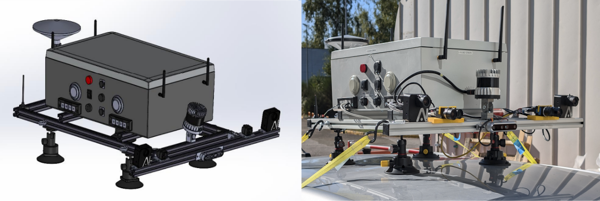

# SPECTRA Dataset: Sensor and  Ground-Truth Toolkit

This dataset is released as part of the [ANR CERBERE Project](#).

  
   
  <em>Figure 1 — The SPECTRA sensor system used for the data aquisition.</em>

**SPECTRA** is a multimodal dataset designed for autonomous driving research. It features synchronized sensor data collected in real-world driving conditions, enabling research in:

- Perception
- Localization
- Sensor fusion
- Depth estimation

## Sensor Setup

- 📷 **2× Stereo Event Cameras** (Prophesee EVK4)
- 📸 **2× Global Shutter RGB Cameras** (Flir Blackfly S)
- 🌀 **LiDAR** (Ouster32)
- 📍 **RTK GNSS & IMU**
- 🎯 **ATLANS A7 INS** — high-precision ground truth for position and orientation

All sensors are **hardware-synchronized**, including **satellite-based PPS** signals and **external trigger management**.

The sections below are a step-by-step guide to recreate these ground truths from your own ROS bag, using the scripts provided in this repo.

## ROS bag contents
| Topic                                        | Type                              | Description               |
| -------------------------------------------- | --------------------------------- | ------------------------- |
| `/ixblue_ins_driver/ix/ins`                  | `ixblue_ins_msgs/Ins`             | Navigation solution (INS) |
| `/ixblue_ins_driver/standard/imu`            | `sensor_msgs/Imu`                 | IMU (INS unit)            |
| `/ixblue_ins_driver/standard/navsatfix`      | `sensor_msgs/NavSatFix`           | GNSS fix (RTK)            |
| `/ixblue_ins_driver/standard/timereference`  | `sensor_msgs/TimeReference`       | GNSS time reference       |
| `/ouster/imu`                                | `sensor_msgs/Imu`                 | IMU (LiDAR unit)          |
| `/ouster/points`                             | `sensor_msgs/PointCloud2`         | 3D LiDAR point cloud      |
| `/prophesee/camera1_master/cd_events_buffer` | `prophesee_event_msgs/EventArray` | Left event stream         |
| `/prophesee/camera1_master/trigger_event`    | `prophesee_event_msgs/Trigger`    | Left trigger events       |
| `/prophesee/camera2_slave/cd_events_buffer`  | `prophesee_event_msgs/EventArray` | Right event stream        |
| `/stereo/left/image_color`                   | `sensor_msgs/Image`               | Left RGB image            |
| `/stereo/right/image_color`                  | `sensor_msgs/Image`               | Right RGB image           |
| `/synchrobox_msg`                            | `std_msgs/String`                 | Sync box status           |
| `/synchrobox_pin0`                           | `std_msgs/Int64MultiArray`        | Sync box digital pin data |

---

Run `rosbag info your.bag` to inspect topics.

## Included Resources

This repository also includes:

- 🔧 **ROS nodes** for synchronizing event cameras (Prophesee master/slave setup)
- 🧩 **Post-processing scripts** for data extraction
- 🧭 **Ground truth generation tools**
- 🌁 **Depth map densification** from sparse LiDAR using semantic segmentation
