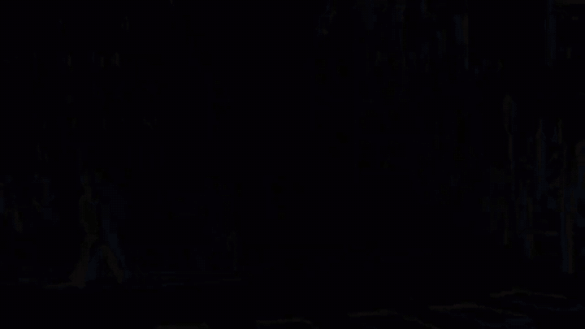
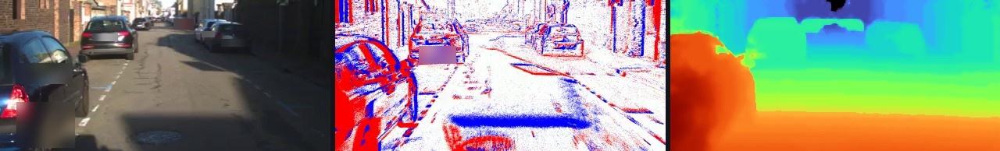

<p align="center">
  <br>
  <sub><a href="docs/media/spectra_teaser.mp4">Watch in full quality (MP4)</a></sub>
</p>

<h1 align="center">SPECTRA</h1>

<p align="center">
  <b>A driving dataset with stereo event cameras, stereo RGB cameras, LiDAR and GPS</b><br>
  <sub>Day, dawn, night and tunnels, recorded on real roads in Normandy, France.</sub>
</p>

<p align="center">
  <a href="https://openreview.net/forum?id=mqCUxEsfsI"></a>
  <a href="#download"></a>
  <a href="toolkit/README.md"></a>
  <a href="LICENSE"></a>
  <a href="https://anr.fr/Project-ANR-21-CE22-0006"></a>
</p>

<p align="center">
  <a href="#what-is-spectra">About</a> ·
  <a href="#whats-inside">What's inside</a> ·
  <a href="#get-started">Get started</a> ·
  <a href="#download">Download</a> ·
  <a href="docs/DATA_FORMAT.md">Data format</a> ·
  <a href="#citation">Citation</a>
</p>

---

## What is SPECTRA?

Event cameras don't take pictures. Each pixel reports the moment its brightness changes, millions of times per
second. This makes them very good where normal cameras struggle: fast motion, darkness and harsh light.

**SPECTRA** lets you study them on the road. We mounted **two event cameras next to two normal (RGB) cameras**,
added a **LiDAR** and an **RTK-GPS/INS**, and drove through towns, suburbs and tunnels by day, at dawn and at
night. Every RGB frame comes with **dense depth**, **stereo disparity** and **semantic labels**, so you can train
and test models for depth, segmentation and more.

SPECTRA was made by the [LITIS laboratory](https://www.litislab.fr/) (Normandie Université / INSA Rouen) within
the [ANR CERBERE project](https://litis-cerbere.univ-rouen.fr/).

## News

- **2026-10-30**: SPECTRA v1.0. Disparity maps for every depth frame and a Python [toolkit](toolkit/README.md).
- **2025**: paper at the IROS 2025 Workshop on Neuromorphic Perception for Real World Robotics (NeuRobots).

## At a glance

| 🎬 **27** sequences | ⏱️ **26 min** of driving | 🛣️ **10.7 km** | 📅 **5** recording days |
|:---:|:---:|:---:|:---:|
| 📷 **31,206** stereo RGB pairs | 🌊 **29,292** frames with dense depth | ⚡ **28.4 billion** events | 💾 about **820 GB** |

## The car

<p align="center"></p>

All sensors sit on the roof, facing forward. From left to right: RGB camera, event camera, event camera, RGB camera,
with the LiDAR just above them.

| | Sensor | Model |
|---|---|---|
| ⚡ | 2 event cameras | Prophesee EVK4 |
| 📷 | 2 RGB cameras, 1280×720 at 20 Hz | FLIR Blackfly S |
| 📡 | LiDAR, 32 beams | Ouster OS1-32 |
| 🛰️ | GPS / INS with RTK | iXblue ATLANS A7 |

<p align="center"></p>
<p align="center"><sub>The same moment seen by the four cameras.</sub></p>

## What's inside

Each sequence folder holds:

| | What you get | Folder |
|---|---|---|
| 📷 | Stereo RGB images | `rgb/` |
| ⚡ | Stereo event streams, plus the camera trigger | `events/` |
| 🏷️ | Semantic segmentation of both RGB cameras (19 Cityscapes classes) | `semantic/` |
| 🌊 | Dense depth up to 50 m, and stereo disparity | `depth/` |
| 📡 | LiDAR map and the car's trajectory | `lidar_ins/` |
| 🎞️ | Small preview videos | `preview/` |
| 💾 | The original ROS recording with every sensor | `raw/` |

<p align="center"></p>
<p align="center"><sub>One sequence, three views: RGB image, events and dense depth (red = near, blue = far).</sub></p>

The depth comes from the LiDAR, spread to every pixel with the help of the segmentation, so object borders stay
sharp. The full method, every file format and the calibration are explained in **[docs/DATA_FORMAT.md](docs/DATA_FORMAT.md)**.

### Sequences

Each sequence is named after the time it was recorded, `YYYY-MM-DD-HH-MM-SS`.

| Day | Conditions | Sequences |
|---|---|---|
| 2024-10-03 | 🏙️ city street, day | `2024-10-03-15-01-07` |
| 2024-10-24 | 🌅 dawn, low light | `2024-10-24-08-15-20`, `2024-10-24-08-15-34` |
| 2024-11-28 | 🌙 night, suburbs | `2024-11-28-18-25-59` |
| 2024-11-29 | 🚇 tunnels, and suburbs by day | `2024-11-29-11-08-17`, `2024-11-29-11-13-51`, `2024-11-29-11-27-15` |
| 2025-07-22 | ☀️ town and suburbs, afternoon | 20 sequences, `2025-07-22-15-51-18` to `2025-07-22-17-06-23` |

## Get started

**1. Download** one sequence (see [Download](#download)) and unzip it. You get a `SPECTRA/` folder.

**2. Install the toolkit:**

```bash
git clone https://github.com/jiheddachraoui/Cerbere.git
cd Cerbere/toolkit
pip install -r requirements.txt
```

**3. Open a sequence:**

```bash
python scripts/quickstart_read.py --root /path/to/SPECTRA --seq 2024-10-24-08-15-20
```

Or in Python:

```python
import spectra as sp

seq   = sp.Sequence("SPECTRA", "2024-10-24-08-15-20")
pair  = next(p for p in seq.pairs if seq.depth(p["stem"]) is not None)

image = seq.rgb(pair, "left")         # the left RGB image
depth = seq.depth(pair["stem"])       # depth in metres
```

The toolkit can also draw depth on the images, turn events into videos, make labels for the right camera and
extract data from the raw recordings. See the **[toolkit guide](toolkit/README.md)**.

## Reading the events

Each sequence has `events/left.h5` (left event camera, `cam2`), `events/right.h5` (right event camera, `cam3`)
and `events/trigger.txt`. The HDF5 files follow the [DSEC](https://dsec.ifi.uzh.ch/) layout:

| Dataset | Type | Meaning |
|---|---|---|
| `events/x` | uint16 | column, 0 to 1279 |
| `events/y` | uint16 | row, 0 to 719 |
| `events/p` | uint8 | polarity: 1 = ON (brightness up), 0 = OFF (brightness down) |
| `events/t` | uint32 | time in µs after `t_offset`, sorted |
| `t_offset` | int64, shape (1,) | start of the file, µs since the Unix epoch (UTC) |
| `ms_to_idx` | uint64 | `ms_to_idx[k]` = index of the first event with `t >= 1000·k` µs |

What to know before you read them:

- **Absolute time = `t_offset + t`**, in µs since the Unix epoch. The left and right files each have their own
  `t_offset`, so compare absolute times only.
- **`import hdf5plugin` first.** The files use the Zstandard HDF5 filter; without it h5py fails with
  `can't find plugin`.
- **Read by time window.** A file holds up to 1.4 billion events: slice it with `ms_to_idx`, never load it whole.
- **Pixels are raw (distorted).** Intrinsics, distortion and extrinsics of `event_left` and `event_right` are in
  `calib.yaml`.
- **Trigger.** `events/trigger.txt` has one edge per line, in **ns** since the Unix epoch (divide by 1000 to compare
  with event times), two edges per 50 ms cycle.

With the toolkit:

```python
import spectra as sp

seq  = sp.Sequence("SPECTRA", "2024-11-28-18-25-59")
pair = seq.pairs[len(seq.pairs) // 2]
t    = int(pair["t_left_ns"]) // 1000                      # RGB stamp, ns -> µs

with seq.events("left") as ev:                              # or "right"
    e = ev.window(t - 10_000, t + 10_000)                   # 20 ms around the image
x, y, p, t_us = e["x"], e["y"], e["p"], e["t"]              # t_us: absolute time (µs)
picture = sp.render(e)                                      # event frame, BGR
edges_ns = seq.trigger_ns()                                 # trigger edges (ns)
```

With plain h5py:

```python
# pip install numpy h5py hdf5plugin
import h5py, hdf5plugin, numpy as np

def read_events(path, t0_us, t1_us):
    """Events with t0_us <= t < t1_us, t in absolute Unix time (µs)."""
    with h5py.File(path, "r") as f:
        off = int(f["t_offset"][0])
        ms, n = f["ms_to_idx"], f["events/t"].shape[0]
        k0 = (t0_us - off) // 1000                       # first millisecond needed
        k1 = -(-(t1_us - off) // 1000)                   # last one, rounded up
        idx = lambda k: 0 if k < 0 else (n if k >= len(ms) else int(ms[k]))
        i0, i1 = idx(k0), idx(k1)
        x, y, p, t = (f["events"][k][i0:i1] for k in ("x", "y", "p", "t"))
    t = t.astype(np.int64) + off                         # absolute time = t_offset + t
    keep = (t >= t0_us) & (t < t1_us)
    return x[keep], y[keep], p[keep], t[keep]

x, y, p, t = read_events("SPECTRA/sequences/2024-11-28-18-25-59/events/left.h5", t0_us, t0_us + 20_000)
frame = np.zeros((720, 1280), np.int32)
np.add.at(frame, (y, x), np.where(p == 1, 1, -1))       # signed event count per pixel
```

To bring a LiDAR point into the left event camera: `p_event = inv(T_rgb_left_event_left) · T_rgb_left_lidar · p_lidar`,
then the `event_left` camera model of `calib.yaml`. More in **[docs/DATA_FORMAT.md](docs/DATA_FORMAT.md)**.

## Download

The data will be available from the project page (link at publication). You can download **one archive per
sequence and per data type**, so you only fetch what you need:

| Archive | Contents |
|---|---|
| `<id>_rgb.zip` | stereo RGB images |
| `<id>_events.zip` | both event streams and the trigger file |
| `<id>_semantic.zip` | segmentation of both cameras |
| `<id>_depth.zip` | dense depth, disparity and their extra maps |
| `<id>_lidar_ins.zip` | LiDAR map and trajectory |
| `<id>_calib.zip` | calibration and the left/right frame pairs |
| `<id>_preview.zip` | the two preview videos |
| `<id>.bag` | the original ROS recording (large) |
| `calibration.zip`, `sequences.csv` | calibration files and the list of sequences |

Unzip all archives into the same folder: they rebuild the `SPECTRA/` tree. To check the files, run
`cd SPECTRA && sha256sum -c --ignore-missing SHA256SUMS`.

## Good to know

A few things worth reading before you use the data. The full list is in **[docs/DATA_NOTES.md](docs/DATA_NOTES.md)**.

- Depth is **pseudo ground truth** made from the LiDAR, up to 50 m. Some frames have no depth on purpose.
- Left and right images are matched through `pairs.csv`, **not by file name**.
- Some sequences drop frames, so don't assume a fixed frame rate.
- The clocks of the different sensors are not merged into one time axis.

## This repository

| Folder | What it is |
|---|---|
| [`toolkit/`](toolkit/README.md) | Python tools to read and visualise SPECTRA |
| [`docs/`](docs) | the data format, the data notes and the figures |

## Citation

If SPECTRA helps your work, please cite:

```bibtex
@inproceedings{dachraoui2025spectra,
  title     = {{SPECTRA}: Synchronized Stereo Event-Camera Driving Dataset for Diverse Perception Tasks},
  author    = {Dachraoui, Jihed and El Moudni, Anass and Planterose, Elsa and Kramm, S{\'e}bastien and Morbidi, Fabio and Boutteau, R{\'e}mi},
  booktitle = {IROS 2025 Workshop on Neuromorphic Perception for Real World Robotics (NeuRobots)},
  year      = {2025},
  url       = {https://openreview.net/forum?id=mqCUxEsfsI}
}
```

## License

The code in this repository is under the [BSD 3-Clause License](LICENSE). The license of the data will be
announced with the release.

## Acknowledgements

This work was supported by the French National Research Agency (ANR) through the
[CERBERE project](https://anr.fr/Project-ANR-21-CE22-0006) (ANR-21-CE22-0006), and funded by Région Normandie.
Computing resources were provided by CRIANN (Normandy, France).

## Contact

Questions about the data or the toolkit? Please [open an issue](https://github.com/jiheddachraoui/Cerbere/issues).
If you appear in the data and want an image removed, open an issue as well and we will get in touch.
