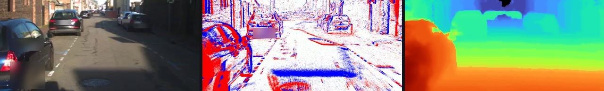
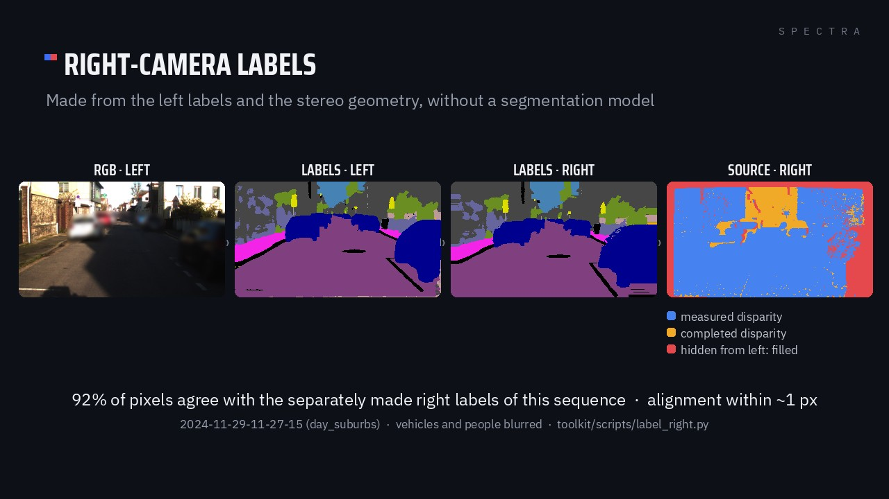
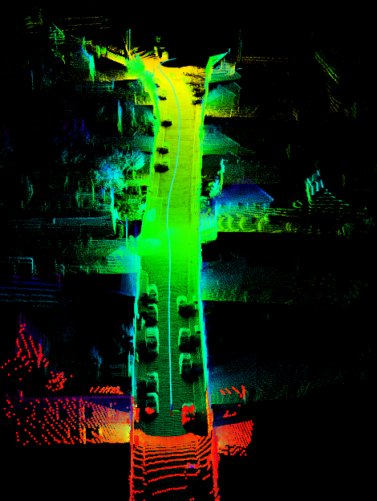

# SPECTRA data format

This page is the full reference: every folder, every file and how to read it. If you are new to SPECTRA, start
with the [main README](../README.md) and the [toolkit](../toolkit/README.md); come back here when you need a detail.

**Contents:** [Folder layout](#folder-layout) · [File formats](#file-formats) · [Timestamps and pairing](#timestamps-and-pairing) ·
[Dense depth](#dense-depth) · [Disparity and right-camera labels](#disparity-and-right-camera-labels) ·
[Calibration](#calibration) · [Raw ROS bags](#raw-ros-bags) · [Reading the data without the toolkit](#reading-the-data-without-the-toolkit)

---

## Folder layout

Every download unpacks into the same tree:

```
SPECTRA/
├── README.md, LICENSE, sequences.csv, SHA256SUMS
├── calibration/
│   └── {2024-10, 2024-11, 2025-07}/calib.yaml, source/
└── sequences/<id>/
    ├── calib.yaml, pairs.csv
    ├── rgb/{left,right}/<timestamp_ns>.png
    ├── semantic/{left,right}/
    ├── events/left.h5, right.h5, trigger.txt
    ├── lidar_ins/scans.pcd, traj.txt
    ├── depth/{dense,sparse,support,moving,disparity}/<timestamp_ns>.png, frames.csv, meta.json
    ├── preview/rgb.avi, events.avi
    └── raw/<id>.bag
```

A sequence `<id>` is the local start time of the recording (Europe/Paris), `YYYY-MM-DD-HH-MM-SS`. The original
recording name (`dawn_01`, `day_suburbs`, ...) is kept in `sequences.csv`, column `recording_name`.

## File formats

| File | Format | What to know |
|---|---|---|
| `rgb/*/*.png` | PNG, 1280×720 | raw (distorted) images; intrinsics in `calib.yaml` |
| `semantic/*/*.png` | PNG | Cityscapes palette colours, on the raw image |
| `events/left.h5`, `right.h5` | HDF5 | datasets `events/x`, `events/y`, `events/p`, `events/t`, `ms_to_idx`, `t_offset`. `t` is in µs after `t_offset`; `ms_to_idx[k]` is the index of the first event of millisecond `k`. You may need `pip install hdf5plugin` |
| `events/trigger.txt` | text | one trigger edge per line (ns), two edges per RGB exposure |
| `lidar_ins/scans.pcd` | PCD | the accumulated LiDAR map, in the map frame |
| `lidar_ins/traj.txt` | text, 8 columns | `# timestamp x y z q_x q_y q_z q_w`: the IMU pose in the map frame, timestamp in seconds |
| `depth/dense/*.png`, `depth/sparse/*.png` | PNG, 16 bit | metres = value / 256, 0 = no depth |
| `depth/disparity/*.png` | PNG, 16 bit | pixels = value / 64, 0 = no disparity |
| `depth/support/*.png` | PNG, 8 bit | 0 = measured LiDAR point, 1 to 254 = distance in pixels to the nearest measured pixel, 255 = no depth |
| `depth/moving/*.png` | PNG, 8 bit | 255 = depth on an object that the live LiDAR sweep shows moving, 0 = not |
| `depth/frames.csv`, `depth/meta.json` | CSV, JSON | per-frame diagnostics of the depth run; encodings and rectified intrinsics |
| `pairs.csv` | CSV | `stem`, `left_file`, `right_file`, `t_left_ns`, `t_right_ns`, `dt_ms`, `residual_ms` |
| `preview/*.avi` | AVI | quick-look videos of the RGB and event streams |
| `raw/<id>.bag` | ROS 1 bag | the original recording, all sensors |

## Timestamps and pairing

- Frame names are PC-clock timestamps in nanoseconds. `rgb/left`, `semantic/left` and `depth/*` use the **left**
  stamp; `rgb/right` has its own stamps.
- Left and right frames are matched **only** through `pairs.csv` (`stem` → `right_file`), never by file name.
- `rgb/` and `semantic/` are on the **raw (distorted)** images; `depth/` is on the **rectified left** image.
- The event cameras record the 20 Hz hardware trigger, GPS-aligned, with two edges per RGB exposure. Event time
  is `t_offset + t` (µs).
- More on timing in the [data notes](DATA_NOTES.md#timing).

## Dense depth

<p align="center"></p>
<p align="center"><sub>2024-11-29-11-27-15 (day_suburbs), left camera: RGB, events and dense depth. Depth colours: 4 m (red) to 50 m (blue), log scale.</sub></p>

Depth comes from the LiDAR. Where the LiDAR measured, the value is the LiDAR's; where it did not, depth is spread
from LiDAR points of the same semantic region.

1. **Map projection.** The LiDAR scans of a sequence are registered with Faster-LIO into one map, which is
   projected into the rectified left image at each frame.
2. **Visibility.** Map points hidden behind closer surfaces are removed, so a wall does not show the street behind it.
3. **Live sweeps.** Each frame is checked against the LiDAR sweep closest in time: the sweep replaces the map on
   moving objects, which go into the moving-object mask.
4. **Segmentation-guided fill.** Pixels without LiDAR take depth from nearby LiDAR points of the same semantic
   class, up to 50 m, so depth does not bleed across object borders.

**Why this way?** LiDAR alone is accurate but sparse, and a map built from it smears moving objects. Stereo
networks give dense depth but less accurate, with soft edges. These maps keep the LiDAR values and only use the
segmentation to decide where they spread. Frames where the map could not be confirmed are left empty rather than
guessed (1,739 of 31,031, listed in `depth/frames.csv`).

**Format:** 16-bit PNG, **metres = value / 256**, 0 = no depth, on the rectified left image (`R_rect_left`,
`P_rect_left` in `calib.yaml`).

## Disparity and right-camera labels

The semantic labels are made on the left camera. To work on the right camera, use the **disparity**
(`depth/disparity/<stem>.png`, 16-bit, **pixels = value / 64**, 0 = none): a pixel (x, y) of the rectified left
image is seen at (x − disparity, y) in the rectified right image. The [toolkit](../toolkit/README.md#3-recipes)
turns any left label map into a complete right label map with this geometry.

<p align="center"></p>

## Calibration

| Epoch | Sequences | Camera calibration | LiDAR to camera | LiDAR to IMU |
|---|---|---|---|---|
| **2024-10** | the October 2024 sessions | Kalibr, 2024-11-04 (shared with 2024-11) | target-based, own rotation measured on the data | GRIL-Calib |
| **2024-11** | the November 2024 sessions | Kalibr, 2024-11-04 | target-based, refined on the data | GRIL-Calib |
| **2025-07** | the 2025-07-22 session | Kalibr, 2025-07-18 | 2025-07-18 | OA-LICalib |

`calibration/<epoch>/calib.yaml` holds the values of each epoch and `source/` the original result files. Each
sequence also has its own `calib.yaml`: the exact values its depth maps were made with.

- Camera ids: `cam0 = rgb_left`, `cam1 = rgb_right`, `cam2 = event_left`, `cam3 = event_right`.
- `T_a_b` means **p_a = T_a_b · p_b**. Reference: the raw `rgb_left` camera.
- `T_rgb_left_trajectory`: from the frame of `lidar_ins/traj.txt` to `rgb_left`.

| | 2024 (Oct and Nov) | 2025-07 |
|---|---|---|
| LiDAR position in camera frame (m) | (0.2494, −0.0567, −0.0446) | (0.2394, −0.0831, −0.0026) |
| LiDAR position in IMU frame (m) | (0.3096, −0.0794, −0.0160) | (0.3174, −0.0844, −0.0226) |
| LiDAR–IMU rotation | 0.79° | 1.62° |
| LiDAR–IMU time lag | −0.0729 s | in the calibration file |

<details>
<summary><b><code>calib.yaml</code> structure (per sequence)</b></summary>

```yaml
sequence: 2024-11-29-11-08-17
epoch: 2024-11
convention: "T_a_b: p_a = T_a_b * p_b, reference = rgb_left (raw)"
cameras:
  rgb_left:    {kalibr_id: cam0, model: pinhole-radtan, resolution: [1280, 720],
                intrinsics_fu_fv_cu_cv: [...], distortion: [...]}
  rgb_right:   {...}
  event_left:  {...}
  event_right: {...}
extrinsics:
  T_rgb_left_rgb_right, T_rgb_left_event_left, T_rgb_left_event_right,
  T_rgb_left_lidar, T_lidar_imu, T_rgb_left_imu, T_rgb_left_trajectory   # 4x4 each
time_lag_imu_to_lidar_s: ...
stereo_rectification:             # the rectified frame of the depth maps and the disparity
  R_rect_left, R_rect_right, P_rect_left, P_rect_right, baseline_m, ...
```

</details>

## Raw ROS bags

Each sequence comes with its original ROS 1 recording, `raw/<id>.bag`. The released RGB, event and trigger files
can be rebuilt from it with the toolkit:

```bash
python toolkit/scripts/raw_bag.py images  raw/<id>.bag --side left --out rgb/left/
python toolkit/scripts/raw_bag.py events  raw/<id>.bag --side left --out events/left.h5
python toolkit/scripts/raw_bag.py trigger raw/<id>.bag --out events/trigger.txt
```

The LiDAR map and trajectory (`lidar_ins/`) come from [Faster-LIO](https://github.com/gaoxiang12/faster-lio); the
settings used for SPECTRA are in [`toolkit/faster_lio/`](../toolkit/faster_lio).

<p align="center"></p>

| Topic | Type | Content |
|---|---|---|
| `/stereo/left/image_color`, `/stereo/right/image_color` | `sensor_msgs/Image` | RGB images (`bgr8`) |
| `/prophesee/camera1_master/cd_events_buffer` | `prophesee_event_msgs/EventArray` | left event stream |
| `/prophesee/camera2_slave/cd_events_buffer` | `prophesee_event_msgs/EventArray` | right event stream |
| `/prophesee/camera1_master/trigger_event` | `prophesee_event_msgs/Trigger` | trigger edges of the left event camera |
| `/ouster/points` | `sensor_msgs/PointCloud2` | LiDAR scans |
| `/ouster/imu` | `sensor_msgs/Imu` | LiDAR IMU |
| `/ixblue_ins_driver/ix/ins` | `ixblue_ins_msgs/Ins` | INS navigation solution |
| `/ixblue_ins_driver/standard/imu` | `sensor_msgs/Imu` | INS IMU |
| `/ixblue_ins_driver/standard/navsatfix` | `sensor_msgs/NavSatFix` | GNSS fix (RTK) |
| `/ixblue_ins_driver/standard/timereference` | `sensor_msgs/TimeReference` | GNSS time reference (2025 bags only) |
| `/synchrobox_msg`, `/synchrobox_pin0` | `std_msgs/String`, `std_msgs/Int64MultiArray` | trigger box |

## Reading the data without the toolkit

Everything is standard files, so plain Python works too:

```python
# pip install numpy opencv-python h5py hdf5plugin pyyaml
import csv, os, cv2, h5py, hdf5plugin, numpy as np, yaml

seq   = "SPECTRA/sequences/2024-10-24-08-15-20"
pairs = list(csv.DictReader(open(f"{seq}/pairs.csv")))
pair  = next(r for r in pairs if os.path.exists(f"{seq}/depth/dense/{r['stem']}.png"))

left  = cv2.imread(f"{seq}/rgb/left/{pair['left_file']}")        # raw (distorted) left image
right = cv2.imread(f"{seq}/rgb/right/{pair['right_file']}")      # its right partner
depth = cv2.imread(f"{seq}/depth/dense/{pair['stem']}.png", cv2.IMREAD_UNCHANGED) / 256.0   # metres

with h5py.File(f"{seq}/events/left.h5", "r") as f:
    ms = f["ms_to_idx"]
    i0, i1 = ms[len(ms) // 2], ms[len(ms) // 2 + 50]            # 50 ms in the middle of the drive
    x, y, p, t = (f["events"][k][i0:i1] for k in ("x", "y", "p", "t"))
    t_abs_us = t.astype(np.int64) + int(f["t_offset"][0])       # absolute time = t_offset + t

# depth lies on the rectified left image: rectify the RGB image to match it
c = yaml.safe_load(open(f"{seq}/calib.yaml"))
cam, rect = c["cameras"]["rgb_left"], c["stereo_rectification"]
fu, fv, cu, cv_ = cam["intrinsics_fu_fv_cu_cv"]
K = np.array([[fu, 0, cu], [0, fv, cv_], [0, 0, 1]])
mx, my = cv2.initUndistortRectifyMap(K, np.array(cam["distortion"]), np.array(rect["R_rect_left"]),
                                     np.array(rect["P_rect_left"])[:, :3], (1280, 720), cv2.CV_32FC1)
left_rect = cv2.remap(left, mx, my, cv2.INTER_LINEAR)           # pixel-aligned with depth
```
