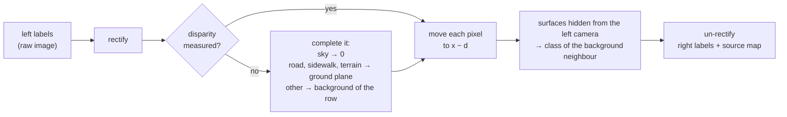

# SPECTRA toolkit

Python tools for the **SPECTRA** dataset: read a sequence, draw depth on the images, render the event streams,
make **full semantic labels for the right camera**, and extract data from the raw ROS bags.

Tested with Python 3.8 and 3.11.

```bash
pip install -r requirements.txt          # numpy, opencv-python, pillow, pyyaml, h5py, hdf5plugin
```

| Script | What it does | Works on |
|---|---|---|
| [`scripts/quickstart_read.py`](scripts/quickstart_read.py) | opens one sequence and prints what a stereo frame holds | release files |
| [`scripts/show_depth.py`](scripts/show_depth.py) | dense depth drawn on the rectified left image (PNG or MP4) | release files |
| [`scripts/render_events.py`](scripts/render_events.py) | event stream rendered as a video | release files |
| [`scripts/label_right.py`](scripts/label_right.py) | full semantic labels for the right RGB camera, from the left labels | release files |
| [`scripts/raw_bag.py`](scripts/raw_bag.py) | images, events, trigger, LiDAR scans, GNSS from a raw bag | `raw/<id>.bag` (ROS 1) |

All scripts take `--root`, the `SPECTRA/` folder of the download, and `--seq`, a sequence id such as
`2024-10-24-08-15-20`.

## Data layout

The tools read the release tree:

```
SPECTRA/sequences/<id>/
├── calib.yaml, pairs.csv
├── rgb/{left,right}/<stamp>.png                    raw (distorted) images
├── semantic/{left,right}/                          labels on the raw images
├── depth/{dense,sparse,support,moving,disparity}/<stem>.png    rectified left image
├── events/left.h5, right.h5, trigger.txt
└── lidar_ins/traj.txt, scans.pcd
```

- Left and right frames are matched **only** through `pairs.csv` (`stem` → `right_file`), never by name.
- RGB and semantic labels are on the **raw** images. Depth, support, moving and disparity are on the
  **rectified left** image (`stereo_rectification` in `calib.yaml`). `spectra.StereoRig` converts between the two.
- Not every pair has depth or disparity. The readers return `None` when a file is missing.

## Python

```python
import spectra as sp

seq   = sp.Sequence("SPECTRA", "2024-10-24-08-15-20")
pair  = next(p for p in seq.pairs if seq.depth(p["stem"]) is not None)

left  = seq.rgb(pair, "left")                  # BGR, raw image
labs  = seq.semantic(pair, "left")             # class ids (Cityscapes train ids, 255 = void)
depth = seq.depth(pair["stem"])                # metres, rectified left image, 0 = none
disp  = seq.disparity(pair["stem"])            # pixels, rectified left image, 0 = none
rect  = seq.rig.rectify_image(left, "left")    # pixel-aligned with depth and disparity

with seq.events("left") as ev:                 # events/left.h5
    t = int(pair["t_left_ns"]) // 1000         # µs
    win = ev.window(t - 25_000, t + 25_000)    # dict of x, y, p, t (absolute µs)
    frame = sp.render(win)                     # BGR event image

right, source = sp.label_right(seq.rig, labs, disp)   # full right labels, see below
```

## Right-camera labels

The semantic labels are made on the left camera. `label_right` turns any left label map (the released
labels, your own corrections or your network's predictions) into a **complete** label map of the right camera,
with no segmentation model, using the stereo geometry:



Every right pixel gets a class, unless the left pixel it comes from is void. The **source map** says how:

| Source | Value | Meaning |
|---|---|---|
| measured | 0 | moved with the released disparity (LiDAR depth) |
| completed | 1 | moved with a completed disparity (sky, ground plane, row background) |
| filled | 2 | not visible to the left camera (occlusions, right-image border): background class |

**Check against independent right labels.** The released right labels were made separately on the right
images. On the test frames of `2025-07-22-16-22-05` the generated right labels agree with them on **91.1 %** of
the pixels both label: 93.5 % for measured, 93.6 % for completed and 80.3 % for filled pixels. A shift test
puts the alignment within about 1 px. The filled pixels are the weakest part; use the source map to weight or
mask them.

```bash
python scripts/label_right.py --root SPECTRA --seq all --out right_labels --save-ids --save-source
python scripts/label_right.py --root SPECTRA --seq 2024-10-24-08-15-34 \
       --left-labels my_predictions/ --out right_labels     # your own left labels
```

Disparity format: `depth/disparity/<stem>.png`, 16-bit, **disparity in pixels = value / 64**, 0 = none. A pixel
(x, y) of the rectified left image is seen at (x − disparity, y) in the rectified right image. It is computed
from the dense depth, disparity = f · B / depth (`-P_rect_right[0,3]` in `calib.yaml`), so it exists wherever
the depth does.

## Raw bags

```bash
python scripts/raw_bag.py info    raw/<id>.bag
python scripts/raw_bag.py images  raw/<id>.bag --side left --out rgb_left/
python scripts/raw_bag.py events  raw/<id>.bag --side left --out left.h5
python scripts/raw_bag.py trigger raw/<id>.bag --out trigger.txt
python scripts/raw_bag.py lidar   raw/<id>.bag --out lidar/            # <time>.bin: float32 x y z intensity
python scripts/raw_bag.py gnss    raw/<id>.bag --out gnss.csv
```

`images`, `events` and `trigger` give **the same files as the release** (checked on `2024-10-24-08-15-20`: same
image names and pixels, identical event arrays, identical trigger file). Image names are the bag record times
in nanoseconds. The camera and INS message packages are not needed, only `rosbag`.

| Topic | Content |
|---|---|
| `/stereo/{left,right}/image_color` | RGB images, `bgr8`, 1280×720 |
| `/prophesee/camera1_master/cd_events_buffer` | left event camera |
| `/prophesee/camera2_slave/cd_events_buffer` | right event camera |
| `/prophesee/camera1_master/trigger_event` | trigger edges of the left event camera |
| `/ouster/points`, `/ouster/imu` | LiDAR scans and LiDAR IMU |
| `/ixblue_ins_driver/standard/{imu,navsatfix}`, `/ixblue_ins_driver/ix/ins` | INS |
| `/ixblue_ins_driver/standard/timereference` | INS time reference (2025 bags only) |
| `/synchrobox_msg`, `/synchrobox_pin0` | trigger box messages |

## LiDAR maps (Faster-LIO)

`lidar_ins/scans.pcd` and `lidar_ins/traj.txt` were made with [Faster-LIO](https://github.com/gaoxiang12/faster-lio)
(ROS 1). [`faster_lio/`](faster_lio) holds the settings used for SPECTRA: copy `ouster32.yaml` into Faster-LIO's
`config/` and `mapping_ouster32.launch` into its `launch/`, build it in a catkin workspace, then

```bash
rosbag play raw/<id>.bag                         # terminal 1
roslaunch faster_lio mapping_ouster32.launch     # terminal 2
```

## Package layout

```
toolkit/
├── spectra/
│   ├── dataset.py         Sequence: paths and readers of the release tree
│   ├── rectify.py         StereoRig: raw <-> rectified images and labels, depth -> disparity
│   ├── semantic.py        classes, colours <-> class ids
│   ├── events.py          EventFile (time windows of an event file), render
│   └── stereo_labels.py   label_right: full right-camera labels
├── scripts/               the command-line tools above
└── faster_lio/            Faster-LIO settings for the Ouster OS1-32 and the iXblue IMU
```
