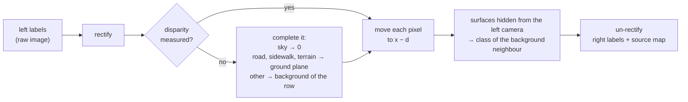

# SPECTRA toolkit

A few simple Python tools to **open, look at and use** the SPECTRA dataset. You don't need to know how the files
are stored: the toolkit finds and reads them for you.

**Contents:** [Install](#1-install) · [Your first look](#2-your-first-look) · [Recipes](#3-recipes) ·
[Use it in Python](#4-use-it-in-python) · [Words you'll meet](#words-youll-meet) · [Advanced](#advanced)

---

## 1. Install

You need **Python 3.8 or newer**. In a terminal:

```bash
git clone https://github.com/jiheddachraoui/SPECTRA.git
cd SPECTRA/toolkit
pip install -r requirements.txt
```

That's all. The tools are in the `scripts/` folder, and you run them from this `toolkit/` folder.

## 2. Your first look

Download at least one sequence and unzip it. You get a folder called `SPECTRA/`. Then run:

```bash
python scripts/quickstart_read.py --root /path/to/SPECTRA --seq 2024-10-24-08-15-20
```

- `--root` is where your `SPECTRA/` folder is.
- `--seq` is the sequence you want. Sequences are named after their recording time. To see which ones you have,
  look inside `SPECTRA/sequences/`.

The script prints what one moment of the drive contains: the two images, the depth, the labels and the events.
If that works, everything is set up.

## 3. Recipes

Pick what you want to do. Every command works the same way: `--root` and `--seq` as above, and `--out` for
where to save the result.

### 🌊 See the depth on top of the images

```bash
python scripts/show_depth.py --root /path/to/SPECTRA --seq 2024-10-24-08-15-20 --out depth.mp4
```

You get a video where each image is coloured by distance: red is near, blue is far. Give a folder name instead
of `depth.mp4` to get separate pictures. Add `--every 10` to use only every 10th frame (faster).

### ⚡ Turn the events into a video

Event cameras don't record images, only changes of light. This tool turns them into a video you can watch:

```bash
python scripts/render_events.py --root /path/to/SPECTRA --seq 2024-10-24-08-15-20 --out events.mp4
```

Add `--side right` for the right event camera, and `--max-seconds 10` to render only the first 10 seconds.

### 🏷️ Get labels for the right camera

The dataset's labels (road, car, person, ...) are made on the **left** camera. This tool builds matching labels
for the **right** camera, using the depth to know where each pixel lands:

```bash
python scripts/label_right.py --root /path/to/SPECTRA --seq 2024-10-24-08-15-20 --out right_labels
```

Use `--seq all` to do every sequence at once. Have your own left labels, for example from your network? Add
`--left-labels my_labels/` and the tool converts those instead.

### 💾 Extract data from the original recordings

Each sequence also has its original recording, a ROS "bag" file (`raw/<id>.bag`). If you want something that
isn't in the ready-made files, you can pull it out yourself. This needs ROS 1 (`rosbag`) installed.

```bash
python scripts/raw_bag.py info    raw/<id>.bag                            # what's inside the recording
python scripts/raw_bag.py images  raw/<id>.bag --side left --out images/  # camera images
python scripts/raw_bag.py events  raw/<id>.bag --side left --out left.h5  # event stream
python scripts/raw_bag.py trigger raw/<id>.bag --out trigger.txt          # camera trigger times
python scripts/raw_bag.py lidar   raw/<id>.bag --out lidar/               # LiDAR scans
python scripts/raw_bag.py gnss    raw/<id>.bag --out gnss.csv             # GPS track
```

The images, events and trigger come out **exactly the same** as the files in the dataset.

## 4. Use it in Python

For your own code, import the `spectra` package (run Python from the `toolkit/` folder, or add it to your path):

```python
import spectra as sp

seq = sp.Sequence("/path/to/SPECTRA", "2024-10-24-08-15-20")   # open one sequence

# one moment of the drive: a left image and its right partner
# (here, the first one that has depth; a few frames have none)
pair = next(p for p in seq.pairs if seq.depth(p["stem"]) is not None)

left   = seq.rgb(pair, "left")             # the left image
right  = seq.rgb(pair, "right")            # the right image
labels = seq.semantic(pair, "left")        # what each pixel is (road, car, ...)
depth  = seq.depth(pair["stem"])           # distance of each pixel, in metres
```

A few more things you can do:

```python
# make the image line up pixel by pixel with the depth
left_aligned = seq.rig.rectify_image(left, "left")

# the events of the 50 ms around this image, drawn as a picture
with seq.events("left") as ev:
    t = int(pair["t_left_ns"]) // 1000                 # image time, in microseconds
    events = ev.window(t - 25_000, t + 25_000)
    picture = sp.render(events)

# labels for the right camera, from the left ones
right_labels, how = sp.label_right(seq.rig, labels, seq.disparity(pair["stem"]))

# list every sequence you have
print(sp.sequence_ids("/path/to/SPECTRA"))
```

## Words you'll meet

| Word | In plain words |
|---|---|
| **Sequence** | one recorded drive, from a few seconds to a few minutes |
| **Pair** | a left image and the right image taken at the same moment. Pairs are listed in `pairs.csv`; left and right files have different names, so always use this list |
| **Stem** | the name of a left image without `.png`. Depth and labels use the same name |
| **Events** | what an event camera records: each pixel reports when its brightness changes, with a time in microseconds |
| **Depth** | the distance from the camera to what each pixel shows, in metres. Made from the LiDAR, up to 50 m |
| **Disparity** | how many pixels a point moves between the left and right image. Close things move more |
| **Rectified** | an image straightened so that left and right line up row by row. Depth and disparity are on the rectified left image, the RGB images are not, so use `rectify_image` to line them up |
| **Labels** | the class of each pixel (road, car, person, sky, ...), the 19 classes of [Cityscapes](https://www.cityscapes-dataset.com/) |

---

## Advanced

<details>
<summary><b>How the right-camera labels are made, and how good they are</b></summary>

`label_right` takes any left label map and, with the stereo geometry and no segmentation model, gives a
**complete** label map of the right camera:



Every right pixel gets a class, unless the left pixel it comes from is void. The **source map** (`--save-source`)
says how:

| Source | Value | Meaning |
|---|---|---|
| measured | 0 | moved with the released disparity (LiDAR depth) |
| completed | 1 | moved with a completed disparity (sky, ground plane, row background) |
| filled | 2 | not visible to the left camera (occlusions, right-image border): background class |

**Quality.** Compared with right labels made independently on the right images (test frames of
`2025-07-22-16-22-05`), the generated labels agree on **91.1 %** of the pixels: 93.5 % for measured, 93.6 % for
completed and 80.3 % for filled pixels, with an alignment within about 1 px. The filled pixels are the weakest;
use the source map to weight or mask them.

Other options: `--save-ids` also saves class-id images, `--per-sequence` reads `--left-labels` with one sub-folder
per sequence.

</details>

<details>
<summary><b>File formats the toolkit reads</b></summary>

```
SPECTRA/sequences/<id>/
├── calib.yaml, pairs.csv
├── rgb/{left,right}/<stamp>.png                    raw (distorted) images
├── semantic/{left,right}/                          labels on the raw images
├── depth/{dense,sparse,support,moving,disparity}/<stem>.png    rectified left image
├── events/left.h5, right.h5, trigger.txt
└── lidar_ins/traj.txt, scans.pcd
```

- Depth: 16-bit PNG, metres = value / 256, 0 = none. Disparity: 16-bit PNG, pixels = value / 64, 0 = none.
- Labels are returned as Cityscapes train ids, 255 = void.
- Events: `ev.window()` returns a dict of `x`, `y`, `p`, `t` with absolute time in µs.
- Not every pair has depth or disparity; the readers return `None` when a file is missing.

The full description of every file is in [docs/DATA_FORMAT.md](../docs/DATA_FORMAT.md).

</details>

<details>
<summary><b>Raw bag topics</b></summary>

| Topic | Content |
|---|---|
| `/stereo/{left,right}/image_color` | RGB images, `bgr8`, 1280×720 |
| `/prophesee/camera1_master/cd_events_buffer` | left event camera |
| `/prophesee/camera2_slave/cd_events_buffer` | right event camera |
| `/prophesee/camera1_master/trigger_event` | trigger edges of the left event camera |
| `/ouster/points`, `/ouster/imu` | LiDAR scans and LiDAR IMU |
| `/ixblue_ins_driver/standard/{imu,navsatfix}`, `/ixblue_ins_driver/ix/ins` | INS |
| `/ixblue_ins_driver/standard/timereference` | INS time reference (2025 bags only) |
| `/synchrobox_msg`, `/synchrobox_pin0` | trigger box messages |

`raw_bag.py` needs only `rosbag`, not the camera or INS message packages. LiDAR scans are saved as
`<time>.bin`, float32 x y z intensity. Image names are the bag record times in nanoseconds.

</details>

<details>
<summary><b>Rebuilding the LiDAR maps (Faster-LIO)</b></summary>

`lidar_ins/scans.pcd` and `lidar_ins/traj.txt` were made with [Faster-LIO](https://github.com/gaoxiang12/faster-lio)
(ROS 1). The [`faster_lio/`](faster_lio) folder holds the settings used for SPECTRA: copy `ouster32.yaml` into
Faster-LIO's `config/` and `mapping_ouster32.launch` into its `launch/`, build it in a catkin workspace, then

```bash
rosbag play raw/<id>.bag                         # terminal 1
roslaunch faster_lio mapping_ouster32.launch     # terminal 2
```

</details>

<details>
<summary><b>What's in this folder</b></summary>

```
toolkit/
├── spectra/               the Python package
│   ├── dataset.py         Sequence: finds and reads the files of a sequence
│   ├── rectify.py         StereoRig: lines images up with the depth, depth -> disparity
│   ├── semantic.py        class names and colours
│   ├── events.py          reads event files, draws events as pictures
│   └── stereo_labels.py   label_right: labels for the right camera
├── scripts/               the ready-to-run tools of the recipes above
└── faster_lio/            Faster-LIO settings for the Ouster OS1-32 LiDAR
```

</details>
